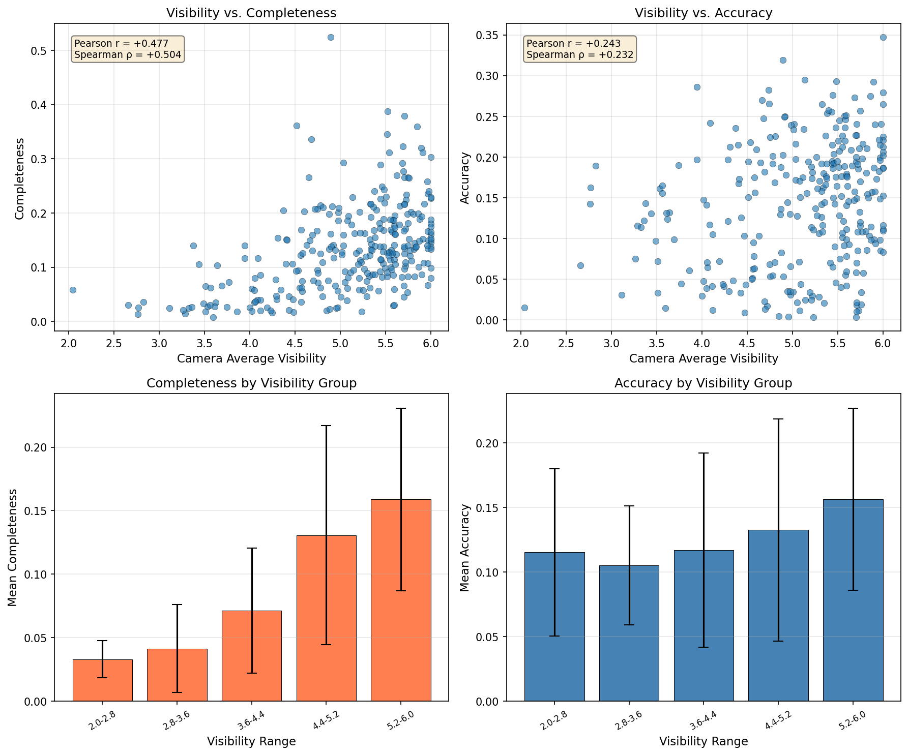
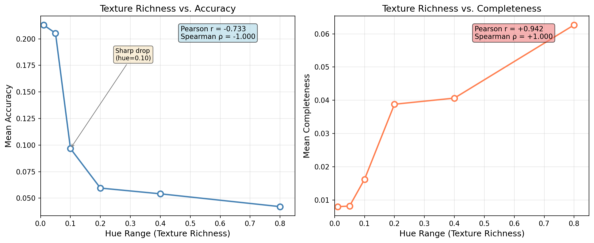

# Surface_Net2D

用 Python 和 Matplotlib 实现的二维多视角表面重建交互演示，通过彩色贝塞尔曲线、模拟相机、颜色一致性和重建置信度，直观展示多视角重建的基本思想。

本项目借鉴 SurfaceNet 的多视角与颜色体素表示思想，使用二维场景和显式颜色一致性计算进行教学演示，不包含原论文的三维神经网络、训练流程或预训练模型。

## 功能

- 拖动贝塞尔曲线控制点，实时观察重建变化。
- 移动、旋转、添加和删除模拟相机。
- 同时展示场景、单相机 CVC 反投影视图、颜色一致性置信度热力图和重建表面。
- 查询网格点在各相机中的投影和颜色，调整一致性阈值并进行表面细化。
- 自动演示几何变化与纹理变化，批量分析它们对重建质量的影响。

## 安装与运行

已在 Windows / Python 3.13.11 下验证。依赖版本见 `requirements.txt`。交互界面使用 Matplotlib 的 TkAgg 后端，需要可用的 Tkinter 和桌面图形环境。

```bash
git clone https://github.com/wang-zx1119/Surface_Net2D.git
cd Surface_Net2D
python -m venv .venv
```

Windows PowerShell 激活环境：

```powershell
.\.venv\Scripts\Activate.ps1
```

macOS / Linux 激活环境：

```bash
source .venv/bin/activate
```

然后安装依赖并启动：

```bash
python -m pip install -r requirements.txt
python main.py
```

可运行 `python -m tkinter` 检查 Tkinter。若使用的 Python 未包含 Tkinter，需要通过对应的 Python 安装器或系统包管理器安装 Tk 支持。

## 运行模式

请在项目根目录执行以下命令：

| 命令 | 说明 |
| --- | --- |
| `python main.py` | 交互演示 |
| `python main.py --demo` | 自动改变曲线几何形状，点击 Start 开始 |
| `python main.py --demo2` | 自动切换纹理色相范围，点击 Start 开始 |
| `python main.py --exp1` | 对 300 条随机曲线进行几何实验，保存 `experiment_1_results.csv` |
| `python main.py --exp2` | 对不同纹理色相范围进行实验，保存 `experiment_2_results.csv` |
| `python plot_exp1.py` | 读取几何实验数据，生成 `experiment_1_analysis.png` |
| `python plot_exp2.py` | 读取纹理实验数据，生成 `experiment_2_analysis.png` |
| `python generate_colorbar.py` | 生成 `texture_gradient.png` 色条示意图 |

仓库包含已有实验数据与分析图，可以直接运行绘图脚本。重新运行实验或绘图会覆盖同名结果文件；随机几何实验的结果可能随运行变化。

## 交互操作

| 操作 | 功能 |
| --- | --- |
| 左键拖动曲线控制点 | 改变曲线形状 |
| 左键拖动相机光心 | 移动相机，并使相机朝向场景中心 |
| 右键拖动相机成像平面 | 旋转相机 |
| 鼠标中键 | 在点击位置添加相机 |
| `a` | 随机添加相机 |
| 点击相机后按 `d` | 删除选中的相机，至少保留两个 |
| 数字键 `1`–`9` | 切换 CVC 视图所使用的相机 |
| `t` | 执行表面细化 |
| `r` | 重置场景 |
| 鼠标滚轮 | 调整颜色一致性阈值 |
| 左键点击热力图或重建视图 | 查看附近网格点的多相机颜色详情 |

进行鼠标交互前，请关闭 Matplotlib 工具栏中的平移或缩放模式。

## 实验示例

几何复杂度与重建质量：



纹理丰富度与重建质量：



## 代码结构

| 文件 | 职责 |
| --- | --- |
| `main.py` | 程序入口、演示和实验模式 |
| `curve.py` | 贝塞尔曲线、采样与颜色映射 |
| `camera.py` | 相机投影、成像和位置更新 |
| `reconstruction.py` | 网格颜色一致性计算、重建、细化和评估 |
| `scene.py` | 场景管理、相机管理和批量实验 |
| `rendering.py` | Matplotlib 场景及重建结果可视化 |
| `interaction.py` | 鼠标与键盘交互 |
| `plot_exp1.py` / `plot_exp2.py` | 实验数据分析和绘图 |
| `generate_colorbar.py` | 纹理色条生成 |

## 许可证

本项目采用 [MIT License](LICENSE)。
